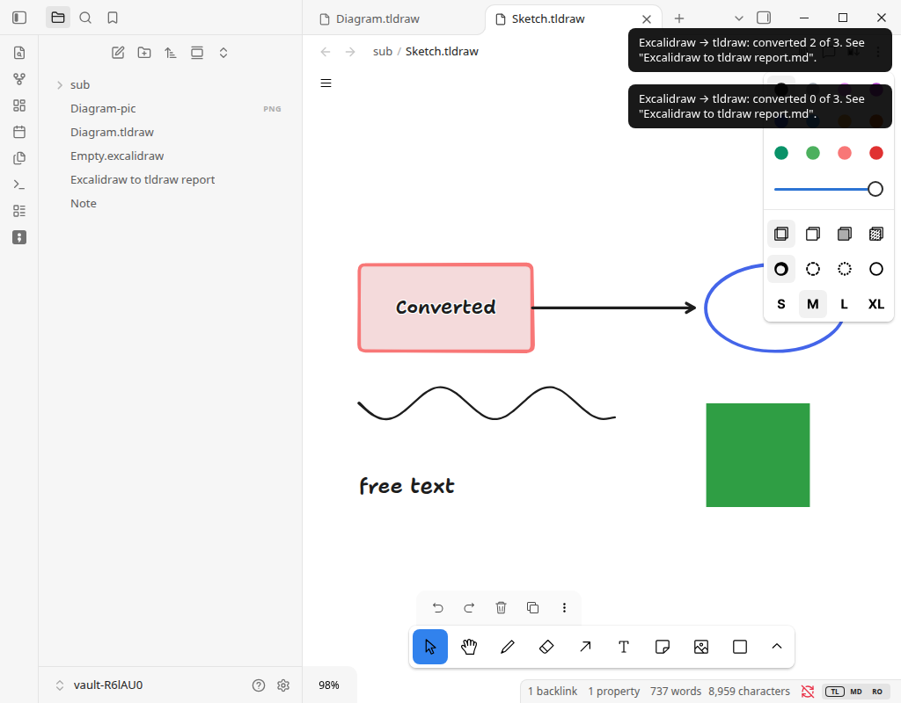

# Excalidraw to tldraw

An Obsidian plugin that converts Excalidraw drawings into drawings for the
[tldraw plugin](https://github.com/tldraw/obsidian-plugin).

It does not translate shapes itself, and it does not ship its own copy of tldraw. It borrows the
tldraw that the tldraw plugin already has loaded, runs tldraw's own Excalidraw importer (the code
behind pasting Excalidraw content into tldraw) on a headless editor, and saves the result in the
tldraw plugin's file format. The output is exactly what your installed tldraw would have written,
so it opens in it.

## Install

Requires the [tldraw plugin](https://github.com/tldraw/obsidian-plugin) 1.33.0 or newer, installed
and enabled.

Download `main.js` and `manifest.json` from the [latest release](../../releases/latest) into
`<vault>/.obsidian/plugins/excalidraw-to-tldraw/`, then enable **Excalidraw to tldraw** under
Settings → Community plugins. Or install it with [BRAT](https://github.com/TfTHacker/obsidian42-brat).

## Use

Command palette:

- **Convert all Excalidraw drawings to tldraw**: every `.excalidraw`, `.excalidraw.md` and note
  with `excalidraw-plugin` in its frontmatter.
- **Convert current Excalidraw drawing to tldraw**

`Drawing.excalidraw.md` becomes `Drawing.tldraw.md` next to it. Originals are never changed or
deleted, an existing target is never overwritten (so re-running is safe), and empty drawings are
skipped. Each run writes `Excalidraw to tldraw report.md` in the vault root: one row per drawing
with what was converted and what was left behind.

## What converts

| Excalidraw | tldraw |
|---|---|
| rectangle, ellipse, diamond (with label) | geo shape |
| freedraw | draw |
| line, arrow (with label and bindings) | line, arrow |
| text | text |
| image | image, kept as a vault file and linked the tldraw plugin's way; inline images are saved as attachments |
| groups, rotation, lock, opacity | kept |
| colours | nearest tldraw colour (tldraw has a fixed palette) |

Left behind and listed in the report: frames, embeds/iframes, LaTeX, embedded notes, images that
point at a web URL or a missing file. Links and embeds elsewhere in the vault still point at the
Excalidraw originals.

## Develop

    npm install
    npm test        # converter, checked with tldraw's own file parser
    npm run e2e     # real Obsidian + the real tldraw plugin open the converted files (needs xvfb)
    npm run build   # main.js

## Licence and credits

MIT, see [LICENSE](LICENSE). This project is not affiliated with tldraw or Excalidraw.

- The conversion itself is done by [tldraw](https://github.com/tldraw/tldraw)'s Excalidraw importer,
  called at run time through the tldraw plugin. No tldraw code is included in this repository or
  its releases; tldraw is a development dependency for the tests only, under its own licence.
- The file format written is that of the [tldraw Obsidian plugin](https://github.com/tldraw/obsidian-plugin) (Apache-2.0).
- The release bundles [lz-string](https://github.com/pieroxy/lz-string) (MIT) to read compressed Excalidraw files.
