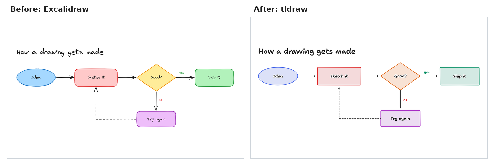
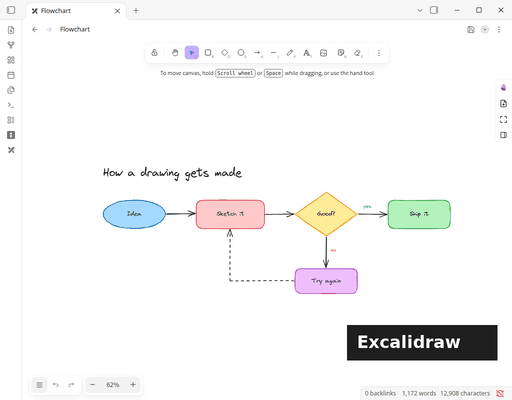

# Tracing Paper

**Move your Excalidraw drawings to tldraw. One command, your whole vault, originals untouched.**

Tracing Paper is an [Obsidian](https://obsidian.md) plugin for people who started drawing in
Excalidraw and now want those drawings in [tldraw](https://github.com/tldraw/obsidian-plugin).
Until now the only way across was copy and paste, one drawing at a time.

## Why you'd want it

- **You have years of drawings.** Converting them by hand is an afternoon you won't spend, so they
  stay stranded. Tracing Paper converts a vault in seconds.
- **You don't trust a migration.** Your originals are never changed, moved or deleted. Converted
  drawings appear next to them. Run it, look, and delete the results if you don't like them.
- **You want it to be right.** Tracing Paper has no shape translator of its own to get wrong. It
  runs tldraw's own Excalidraw importer, the same code behind paste, inside your installed tldraw
  plugin. What you get is what tldraw itself would have made.

## What it looks like

Handwriting and sketches come across stroke for stroke, as editable tldraw ink:

Both drawings above are in [`demo/`](demo). Drop them in a vault and try it.

### On other people's drawings

These are community libraries from [libraries.excalidraw.com](https://libraries.excalidraw.com),
converted as they come (credits in [`demo/public/`](demo/public)):

## How close is it?

Close, not identical. tldraw is a different drawing tool, and some things have no equivalent:

- **One colour per shape.** Excalidraw lets a shape have one outline colour and another fill colour;
  tldraw gives a shape a single colour from a fixed palette. White fills keep their outline colour
  and solid dark fills stay solid; other fills take the fill's colour.
- **Fonts.** Text keeps its size and position, in tldraw's own hand-drawn, sans or mono font.
- **Filled outlines.** A closed line with a fill becomes an unfilled line.
- **Line weights and dashes** map to tldraw's nearest preset.

Simple diagrams and handwriting come across nearly unchanged. Dense, heavily styled drawings such
as the wireframe kit above keep their content and layout but lose some styling.

## Get started

1. Install and enable the [tldraw plugin](https://github.com/tldraw/obsidian-plugin) (1.33.0 or newer).
2. Install Tracing Paper: download `main.js` and `manifest.json` from the
   [latest release](../../releases/latest) into `<vault>/.obsidian/plugins/tracing-paper/`, or add
   this repository in [BRAT](https://github.com/TfTHacker/obsidian42-brat).
3. Enable **Tracing Paper** under Settings → Community plugins.
4. Open the command palette and run **Convert all Excalidraw drawings to tldraw**.

`Sketch.excalidraw.md` becomes `Sketch.tldraw.md`, in the same folder. To convert one drawing, open
it and run **Convert current Excalidraw drawing to tldraw**.

## What you can count on

- **Originals are untouched.** Nothing is overwritten: if `Sketch.tldraw.md` already exists it is
  left alone, so running the command twice is safe.
- **You get a receipt.** Every run writes `Excalidraw to tldraw report.md` in the vault root: one
  row per drawing, with what converted and anything that was left behind.
- **It finds every drawing.** `.excalidraw` files, `.excalidraw.md` files, and older notes that are
  only marked as drawings in their frontmatter. Empty drawings are skipped.
- **Nothing leaves your vault.** The plugin makes no network requests and has no account or telemetry.

## What converts

| In Excalidraw | In tldraw |
|---|---|
| Rectangles, ellipses, diamonds, with their labels | Shapes with labels |
| Freehand drawing | Ink strokes |
| Lines and arrows, with labels and connections | Lines and arrows that stay attached |
| Text | Text |
| Images | Images. They stay files in your vault; images stored inside a drawing are saved as attachments |
| Groups, rotation, lock, opacity | Kept |

Good to know, because tldraw is a different tool:

- **Colours** snap to the nearest colour in tldraw's palette. Light greys become grey, dark greys
  become black.
- **Arrows with corners** become curved arrows.
- **Frames** become tldraw frames, with their contents inside.
- **Left behind**, and listed in the report: web embeds, LaTeX, embedded notes, and images
  that point at a web address or a missing file.
- **Links** elsewhere in your vault keep pointing at the Excalidraw originals.

## Questions

**Do I need the Excalidraw plugin installed?** No. Tracing Paper reads the files directly.

**Can I go back?** Your Excalidraw files never changed. Delete the `.tldraw.md` files and you are
where you started.

**Does it work on mobile?** It is built to, but it has only been tested on desktop.

**Something converted badly.** Please [open an issue](../../issues) with the row from the report.

## For developers

    npm install
    npm test        # the converter, checked with tldraw's own file parser
    npm run e2e     # real Obsidian and the real tldraw plugin open the converted files (needs xvfb)
    npm run build   # main.js

The whole plugin is three files in `src/`: `parse.ts` reads Excalidraw files, `convert.ts` drives
tldraw's importer on a headless editor, and `main.ts` is the Obsidian side.

## Licence and credits

MIT, see [LICENSE](LICENSE). Tracing Paper is an independent project, not affiliated with tldraw,
Excalidraw or Obsidian.

- The conversion is done by [tldraw](https://github.com/tldraw/tldraw)'s Excalidraw importer,
  called at run time through the tldraw plugin. No tldraw code is included in this repository or
  its releases; tldraw is a development dependency for the tests only, under its own licence.
- The file format written is that of the [tldraw Obsidian plugin](https://github.com/tldraw/obsidian-plugin) (Apache-2.0).
- Releases bundle [lz-string](https://github.com/pieroxy/lz-string) (MIT) to read compressed Excalidraw files.
